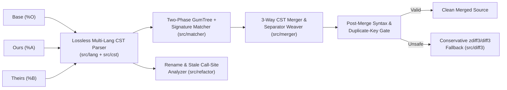

# MoonGraft (`snozzz/moongraft`)

**Syntax-Aware 3-Way CST Merge Engine, Move-Edit Refactoring Resolver & Multi-Agent Git Merge Driver in Pure MoonBit**

> **2026 MoonBit Hackathon Entry** — Built with 100% pure, zero-FFI core MoonBit (`wasm-gc`, `js`, and `native` targets) to solve false Git merge conflicts across human teams and parallel AI coding agents.

---

## Why MoonGraft?

Line-based `git merge` (`diff3`) treats source code and structured configuration files as flat arrays of lines. In modern **AI-assisted & multi-agent software engineering** (where multiple parallel agents or developers concurrently edit the same repository), `git merge` routinely fails on safe, non-overlapping semantic changes:

1. **MoonBit `///|` Block Additions & Reordering**: MoonBit source files organize declarations into order-independent `///|` blocks, yet two branches appending `pub fn` or `test` blocks at EOF—or moving a function while another branch edits its body—trigger immediate line conflicts.
2. **The JSON / `moon.pkg` Trailing-Comma Trap**: Branch A appends `"zod": "^3.23.8"` (adding a comma to the previous last line) while Branch B appends `"vite": "^6.0.0"`. Line `diff3` flags a conflict, and naive manual resolution often leaves missing or duplicate commas.
3. **Parallel Manifest & Workflow Evolution**: Adding disjoint dependencies in `Cargo.toml` (or inline table flags `serde = { ... }`), `moon.pkg` `import { ... }` blocks, or named steps in GitHub Actions `.yml` workflows causes constant false conflicts.
4. **Cross-Branch Symbol Renames**: Branch A renames `parse_config` to `load_config` while Branch B adds a new caller invoking `parse_config(...)`—producing a silent semantic break that text-based merge tools miss completely.

**MoonGraft** brings **Mergiraf / GumTree-class lossless Concrete Syntax Tree (CST) 3-way merging** natively to the MoonBit ecosystem—supporting **MoonBit (`.mbt`, `.mbti`)**, **MoonBit Manifests (`moon.pkg`, `moon.mod`)**, **JSON/JSONC**, **TOML**, **YAML**, **TypeScript/JavaScript**, **Python**, and **Rust**.

---

## Architecture Overview



### Core Technical Highlights

- **Lossless Full-Fidelity CST (`src/cst`)**: Preserves 100% of whitespace, indentation, comments, and MoonBit `///|` block separators (`parse_cst(src, lang).unparse() == src` byte-for-byte), paired with dual 64-bit Merkle hashes (`structural_hash` using order-independent XOR+Sum multiset mixing vs trivia-exact `exact_hash`).
- **Two-Phase GumTree + Semantic Signature Matching (`src/matcher`)**: Combines height-priority top-down isomorphic subtree discovery with declaration-signature matching (`fn:...`, `struct:...`, `key:...`, `table:...`, `import:...`), bottom-up Dice container recovery, and Longest Increasing Subsequence (LIS) move detection.
- **Move + Edit Composition & Recursive Container Weaving (`src/merger`)**: Composes function/block moves on one branch with inner statement edits on the other, normalizes commas in JSON/TOML/`moon.pkg`, merges newly created matching sections (`[dev-dependencies]`, `"scripts"`), and preserves true conflicts (`Delete-Modify`, scalar value clashes) with zero silent data loss.
- **Post-Merge Syntactic & Duplicate-Key Soundness Gate (`src/lang/detect.mbt`)**: Every conflict-free CST merge is re-parsed and checked for balanced delimiters, grammar validity, and zero duplicate keys/declarations before acceptance; any violation safely falls back to `diff3`.
- **Post-Facto Conflict Solver (`src/solver`) & Multi-Agent Octopus Workspace Merger (`src/workspace`)**: Resolves existing `<<<<<<< / ||||||| / ======= / >>>>>>>` markers in place (`moongraft solve`), detects cross-branch rename hazards (`src/refactor`), and reconciles $K \ge 2$ parallel AI agent file trees in memory.

---

## Quantitative Benchmark & Verification Results

### 1. Accuracy vs Standard `git merge-file --diff3`

Evaluated on the built-in 16-scenario multi-language corpus (`./scripts/moongraft-cli.sh bench-suite`) and verified against real `git merge-file --diff3`, Python `json` / `tomllib` / `ast`, and the `moon check` compiler (`python3 scripts/verify_harness.py`):

| Metric | Standard Line `diff3` | `MoonGraft` CST Merge |
| :--- | :---: | :---: |
| **Resolvable Parallel / Move-Edit Scenarios Cleanly Merged** | 1 / 13 (7.7%) | **13 / 13 (100.0%)** |
| **True Semantic Conflicts Soundly Flagged (0 Silent Loss)** | 3 / 3 (100.0%) | **3 / 3 (100.0%)** |
| **Merged Output Syntax & Compiler Validity (`moon check`, `json`, `tomllib`)** | N/A | **100.0%** |
| **120 Randomized Property-Based Trials (Idempotency, Identity, Commutativity)** | — | **120 / 120 Passed** |

### 2. Performance (`moon bench --release`, Wasm-GC Backend)

| Benchmark Workload | Mean Latency (± σ) | Min … Max |
| :--- | :---: | :---: |
| **80-Function MoonBit Module 3-Way CST Merge** | `1.08 ms ± 150 µs` | `926 µs … 1.39 ms` |
| **100-Dependency `package.json` 3-Way CST Merge** | `960 µs ± 62 µs` | `901 µs … 1.08 ms` |
| **Full 16-Scenario Multi-Language Corpus Evaluation** | `697 µs ± 53 µs` | `645 µs … 787 µs` |

---

## Library Usage (`moon.pkg` API)

The code block below is type-checked and tested directly by `moon test`:

```mbt check
///|
test "readme quickstart: merge parallel package.json edits" {
  let base = "{\n  \"name\": \"app\",\n  \"dependencies\": {\n    \"react\": \"^19.0.0\"\n  }\n}\n"
  let ours = "{\n  \"name\": \"app\",\n  \"dependencies\": {\n    \"react\": \"^19.0.0\",\n    \"zod\": \"^3.23.8\"\n  }\n}\n"
  let theirs = "{\n  \"name\": \"app\",\n  \"dependencies\": {\n    \"react\": \"^19.0.0\",\n    \"vite\": \"^6.0.0\"\n  }\n}\n"

  let result = @moongraft.merge(base, ours, theirs, path="package.json")
  assert_eq(result.conflict_count, 0)
  assert_true(result.line_diff3_conflicts >= 1)
  assert_true(result.syntax_valid)
  assert_true(result.merged_text.contains("\"zod\": \"^3.23.8\""))
  assert_true(result.merged_text.contains("\"vite\": \"^6.0.0\""))
}
```

---

## CLI & Git Merge Driver Quickstart

### Build & Verify

```bash
moon check
moon test
moon build --target js --release
cp _build/js/release/build/cmd/main/main.js web/moongraft.bundle.js

# Run 3-way merge on example MoonBit Move + Edit files
./scripts/moongraft-cli.sh merge \
  examples/moonbit_move_edit/base.mbt \
  examples/moonbit_move_edit/ours.mbt \
  examples/moonbit_move_edit/theirs.mbt

# Resolve an already-conflicted file containing <<<<<<< markers
./scripts/moongraft-cli.sh solve examples/conflicted_sample.mbt

# Structural AST diff (highlights Moved and Moved+Modified declarations)
./scripts/moongraft-cli.sh diff \
  examples/moonbit_move_edit/base.mbt \
  examples/moonbit_move_edit/ours.mbt

# Run full 16-case benchmark table + external compiler-in-the-loop harness
./scripts/moongraft-cli.sh bench-suite
python3 scripts/verify_harness.py
```

### Register as Git Merge Driver

Run `./scripts/moongraft-cli.sh setup` or add to `.gitconfig`:

```ini
[merge]
    conflictStyle = diff3
[merge "moongraft"]
    name = MoonGraft syntax-aware 3-way CST merge driver
    driver = /path/to/moongraft/scripts/moongraft-cli.sh merge %O %A %B -o %A -p %P -L %X -L %Y -L %P
```

And in your repository's `.gitattributes`:

```gitattributes
*.mbt         merge=moongraft
*.mbti        merge=moongraft
moon.pkg      merge=moongraft
moon.mod      merge=moongraft
*.json        merge=moongraft
*.toml        merge=moongraft
*.yaml        merge=moongraft
*.yml         merge=moongraft
*.ts          merge=moongraft
*.py          merge=moongraft
*.rs          merge=moongraft
```

### Interactive Web Workbench

Open `web/index.html` directly in any modern browser (after running `moon build --target js --release && cp _build/js/release/build/cmd/main/main.js web/moongraft.bundle.js`) to compare standard `git merge-file --diff3` against `MoonGraft` in real time, inspect the CST S-expression tree, and trace structural resolution events.

---

## Package Layout

| Package | Responsibility |
| :--- | :--- |
| `snozzz/moongraft` | High-level ergonomic API (`merge`, `solve_conflicts`, `structural_diff`, `analyze_renames`, `reconcile_workspaces`) |
| `src/cst` | Lossless Red-Green CST, trivia preservation, SplitMix64/FNV-1a structural & exact Merkle hashes, `SourceMap`, S-exp |
| `src/diff3` | Patience/Myers 3-way line `diff3`, zealous `zdiff3` wrapper hoisting, atomic-literal-safe intra-line token merge |
| `src/lang` | Six lossless CST parsers (`MoonBit`, `moon.pkg`/`moon.mod`, `JSON/JSONC`, `TOML`, `YAML`, `TS/Python/Rust`) + syntax validator |
| `src/matcher` | Two-phase GumTree top-down Merkle matcher, semantic signature matcher, Dice container recovery, LIS move detector |
| `src/merger` | 3-way commutative/sequential CST merger, comma & `///|` separator weaver, post-merge soundness safety gate |
| `src/solver` | Post-facto inline `<<<<<<< / ||||||| / ======= / >>>>>>>` conflict marker parser & structural solver |
| `src/refactor` | Cross-branch declaration rename detector (`Dice >= 65%`) & stale call-site semantic hazard analyzer |
| `src/workspace` | Multi-agent N-way Octopus file & directory tree reconciler |
| `src/report` | 16-scenario multi-language benchmark corpus, Markdown/JSON formatters, Git config snippet generators |
| `cmd/main` | Cross-target CLI (`merge`, `solve`, `diff`, `inspect`, `bench-suite`, `setup`) & Browser JS runtime bridge |

---

## Acknowledgments & Open-Source Compliance

- **License**: Apache-2.0 (`LICENSE`).
- **Algorithmic Inspiration & External Baselines**: Inspired by the tree-matching literature of **GumTree** (Falleri et al., ASE 2014) and syntax-aware Git merging pioneered by **Mergiraf** (Delafosse, MIT/Apache-2.0) and **Difftastic** (Wilfred Hughes, MIT). All parsers, CST representations, Merkle hashing, matching, 3-way weaving, rename analysis, and multi-agent workspace reconciliation in `MoonGraft` are original, clean-room pure MoonBit implementations.
