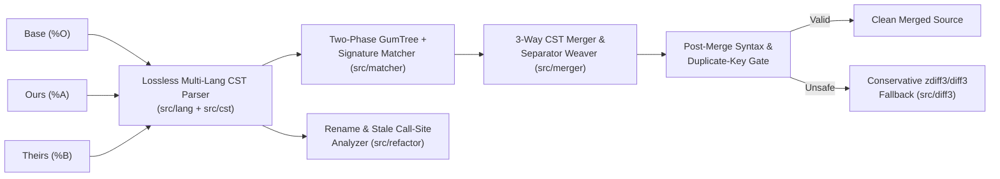

# MoonGraft (`snozzz/moongraft`)

[](https://github.com/snozzz/moongraft/actions/workflows/ci.yml)
[](https://mooncakes.io/docs/snozzz/moongraft)
[](LICENSE)

**Syntax-Aware 3-Way CST Merge Engine, Move-Edit Refactoring Resolver & Multi-Agent Git Merge Driver in Pure MoonBit**

> **2026 MoonBit Hackathon Entry** — Reusable `mooncakes.io`-ready library + Git Merge Driver CLI + Interactive Web Workbench, written in 100% pure, zero-FFI core MoonBit (`wasm-gc`, `wasm`, `js`, and `native` targets).

---

## Minimal Quickstart & One-Command Demo

Clone the repository and run the minimal self-contained demo with **a single command** (works on any platform with the latest MoonBit toolchain):

```bash
# Option A: Pure-MoonBit zero-FFI showcase (runs on default wasm-gc target, no Node/Python needed)
moon run cmd/demo

# Option B: Full minimal demo script (toolchain check + Wasm showcase + CLI file merge)
./demo.sh
```

### Use as a Reusable Library (`mooncakes.io`)

```bash
moon add snozzz/moongraft
```

Import `"snozzz/moongraft"` in your `moon.pkg` and call `@moongraft.merge`, `@moongraft.solve_conflicts`, `@moongraft.structural_diff`, `@moongraft.analyze_renames`, or `@moongraft.reconcile_workspaces`. The block below is compiled and verified directly by `moon test --deny-warn`:

```mbt check
///|
test "readme quickstart: merge parallel package.json edits" {
  let base = "{\n  \"name\": \"app\",\n  \"dependencies\": {\n    \"react\": \"^19.0.0\"\n  }\n}\n"
  let ours = "{\n  \"name\": \"app\",\n  \"dependencies\": {\n    \"react\": \"^19.0.0\",\n    \"zod\": \"^3.23.8\"\n  }\n}\n"
  let theirs = "{\n  \"name\": \"app\",\n  \"dependencies\": {\n    \"react\": \"^19.0.0\",\n    \"vite\": \"^6.0.0\"\n  }\n}\n"

  let result = @moongraft.merge(base, ours, theirs, path="package.json")
  inspect(result.conflict_count, content="0")
  assert_true(result.line_diff3_conflicts >= 1)
  inspect(result.syntax_valid, content="true")
  assert_true(result.merged_text.contains("\"zod\": \"^3.23.8\""))
  assert_true(result.merged_text.contains("\"vite\": \"^6.0.0\""))
}
```

---

## Why MoonGraft?

Line-based `git merge` (`diff3`) treats source code and structured configuration files as flat arrays of lines. In modern **AI-assisted & multi-agent software engineering**, `git merge` routinely fails on safe, non-overlapping semantic changes:

1. **MoonBit `///|` Block Additions & Reordering**: MoonBit source files organize declarations into order-independent `///|` blocks, yet two branches appending `pub fn` or `test` blocks at EOF—or moving a function while another branch edits its body—trigger immediate line conflicts.
2. **The JSON / `moon.pkg` Trailing-Comma Trap**: Branch A appends `"zod": "^3.23.8"` (adding a comma to the previous last line) while Branch B appends `"vite": "^6.0.0"`. Line `diff3` flags a conflict, and manual resolution often leaves missing or stray commas.
3. **Parallel Manifest & Workflow Evolution**: Adding disjoint dependencies in `Cargo.toml` (including inline tables `serde = { ... }`), `moon.pkg` `import { ... }` blocks, or named steps in GitHub Actions `.yml` workflows causes constant false conflicts.
4. **Cross-Branch Symbol Renames**: Branch A renames `parse_config` to `load_config` while Branch B adds a new caller invoking `parse_config(...)`—producing a silent semantic break that text-based merge tools miss completely.

**MoonGraft** brings lossless Concrete Syntax Tree (CST) 3-way structural merging natively to the MoonBit ecosystem across **MoonBit (`.mbt`, `.mbti`)**, **MoonBit Manifests (`moon.pkg`, `moon.mod`)**, **JSON/JSONC**, **TOML**, **YAML**, **TypeScript/JavaScript**, **Python**, **Rust**, **Go**, and **C/C++**.

---

## Architecture Overview



---

## Quantitative Benchmark & Verification Results

### 1. Accuracy vs Standard `git merge-file --diff3`

Evaluated on the built-in 16-scenario multi-language corpus (`moon run cmd/demo` / `./scripts/moongraft-cli.sh bench-suite`) and verified against real `git merge-file --diff3`, Python `json` / `tomllib` / `ast`, and the `moon check` compiler (`python3 scripts/verify_harness.py`):

| Metric | Standard Line `diff3` | `MoonGraft` CST Merge |
| :--- | :---: | :---: |
| **Resolvable Parallel / Move-Edit Scenarios Cleanly Merged** | 1 / 15 (6.7%) | **15 / 15 (100.0%)** |
| **True Semantic Conflicts Soundly Flagged (0 Silent Loss)** | 3 / 3 (100.0%) | **3 / 3 (100.0%)** |
| **Merged Output Syntax & Compiler Validity (`moon check`, `json`, `tomllib`)** | N/A | **100.0%** |
| **120 Randomized Property-Based Trials (Idempotency, Identity, Commutativity)** | — | **120 / 120 Passed** |

### 2. Performance (`moon bench --release`, Wasm-GC Backend)

| Benchmark Workload | Mean Latency (± σ) | Min … Max |
| :--- | :---: | :---: |
| **80-Function MoonBit Module 3-Way CST Merge** | `1.08 ms ± 150 µs` | `926 µs … 1.39 ms` |
| **100-Dependency `package.json` 3-Way CST Merge** | `960 µs ± 62 µs` | `901 µs … 1.08 ms` |
| **Full 16-Scenario Multi-Language Corpus Evaluation** | `697 µs ± 53 µs` | `645 µs … 787 µs` |

---

## CLI & Git Merge Driver Usage

```bash
moon check --target all --deny-warn
moon test --deny-warn
moon build --target js --release
cp _build/js/release/build/cmd/main/main.js web/moongraft.bundle.js

# 1. 3-way structural file merge
./scripts/moongraft-cli.sh merge \
  examples/moonbit_move_edit/base.mbt \
  examples/moonbit_move_edit/ours.mbt \
  examples/moonbit_move_edit/theirs.mbt

# 2. Post-facto conflict marker solver (resolves existing <<<<<<< markers)
./scripts/moongraft-cli.sh solve examples/conflicted_sample.mbt

# 3. Syntax-aware structural AST diff (Moved, Moved+Modified, Inserted, Deleted)
./scripts/moongraft-cli.sh diff \
  examples/moonbit_move_edit/base.mbt \
  examples/moonbit_move_edit/ours.mbt

# 4. Cross-branch rename & stale call-site hazard audit
./scripts/moongraft-cli.sh analyze-renames \
  examples/moonbit_move_edit/base.mbt \
  examples/moonbit_move_edit/ours.mbt \
  examples/moonbit_move_edit/theirs.mbt

# 5. Print .gitattributes and .gitconfig setup snippets
./scripts/moongraft-cli.sh setup
```

---

## Package Layout

| Package | Responsibility |
| :--- | :--- |
| `snozzz/moongraft` | Public library facade (`merge`, `solve_conflicts`, `structural_diff`, `analyze_renames`, `reconcile_workspaces`) |
| `src/cst` | Lossless Red-Green CST, trivia preservation, SplitMix64/FNV-1a structural & exact Merkle hashes, `SourceMap`, S-exp |
| `src/diff3` | Patience/Myers 3-way line `diff3`, zealous `zdiff3` wrapper hoisting, atomic-literal-safe intra-line token merge |
| `src/lang` | Six lossless CST parsers (`MoonBit`, `moon.pkg`/`moon.mod`, `JSON/JSONC`, `TOML`, `YAML`, `TS/Python/Rust`) + syntax validator |
| `src/matcher` | Two-phase GumTree top-down Merkle matcher, semantic signature matcher, Dice container recovery, LIS move detector |
| `src/merger` | 3-way commutative/sequential CST merger, comma & `///|` separator weaver, post-merge soundness safety gate |
| `src/solver` | Post-facto inline `<<<<<<< / ||||||| / ======= / >>>>>>>` conflict marker parser & structural solver |
| `src/refactor` | Cross-branch declaration rename detector (`Dice >= 65%`) & stale call-site semantic hazard analyzer |
| `src/workspace` | Multi-agent N-way Octopus file & directory tree reconciler |
| `src/report` | 16-scenario multi-language benchmark corpus, Markdown/JSON formatters, Git config snippet generators |
| `cmd/demo` | Pure-MoonBit zero-FFI minimal runnable demo (`moon run cmd/demo`) |
| `cmd/main` | Production Git merge driver CLI (`merge`, `solve`, `diff`, `inspect`, `analyze-renames`, `bench-suite`, `setup`) & Browser JS bridge |

---

## Upstream Reference, Porting Scope & Open-Source Compliance

- **Project License**: Apache License 2.0 (`LICENSE`).
- **Algorithmic Literature & Ecosystem References**:
  - **GumTree AST Diffing Algorithm**: Falleri et al., *"Fine-grained and accurate source code differencing"* (ASE 2014) — reference [`GumTreeDiff/gumtree`](https://github.com/GumTreeDiff/gumtree) (LGPL-3.0, paper algorithm only; zero code copied).
  - **Syntax-Aware Diff & 3-Way Structural Merge Paradigm**: Functional UX and Git merge-driver workflow inspired by [`Wilfred/difftastic`](https://github.com/Wilfred/difftastic) (MIT License) and the syntax-aware 3-way CST merge workflow popularized in the Rust ecosystem (`mergiraf` CLI conventions; zero source code or grammar files copied).
- **Clean-Room MoonBit Design & Scope**:
  - **Implemented in `MoonGraft` (`v0.1.0`)**: Clean-room pure MoonBit Red-Green CST, SplitMix64 commutative multiset Merkle hashing, 6 built-in lossless language parsers (including **MoonBit `.mbt`/`.mbti` `///|` block semantics** and **`moon.pkg`/`moon.mod` DSL**, which have no upstream counterpart in Rust/Java tools), comma/separator synthesis, `moongraft solve` post-facto conflict solver, cross-branch rename stale-reference hazard detection, multi-agent N-way Octopus workspace reconciliation, and post-merge syntactic/duplicate-signature soundness verification.
  - **Out of Scope / Future Roadmap (`v0.2+`)**: Foreign C `tree-sitter` dynamic grammar loading (intentionally omitted to preserve 100% zero-FFI `wasm-gc` / `js` / `native` portability) and C preprocessor macro expansion.
